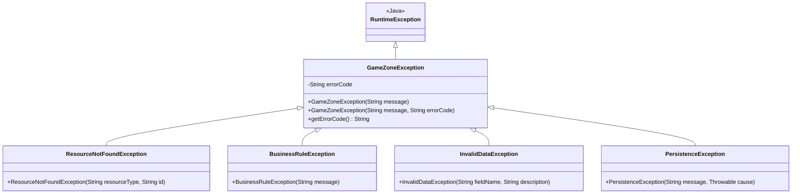
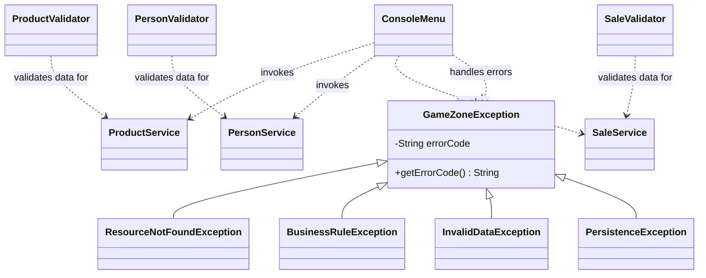

# Exception Class Diagram

The following diagram represents the custom exception hierarchy designed for GameZoneUnicesar.

## Description

- `GameZoneException` is the base class for application-specific exceptions and stores an error code.
- `ResourceNotFoundException` represents a resource that cannot be found.
- `BusinessRuleException` represents a violation of a business rule.
- `InvalidDataException` represents invalid input data.
- `PersistenceException` represents an error when accessing or storing data and preserves the original cause.

## Validation and Application Integration

The validation layer checks input data before the service layer performs business operations.

The validators are responsible for checking input data, while services coordinate business operations. The console interface invokes services and handles application-specific exceptions to display understandable messages to users.
