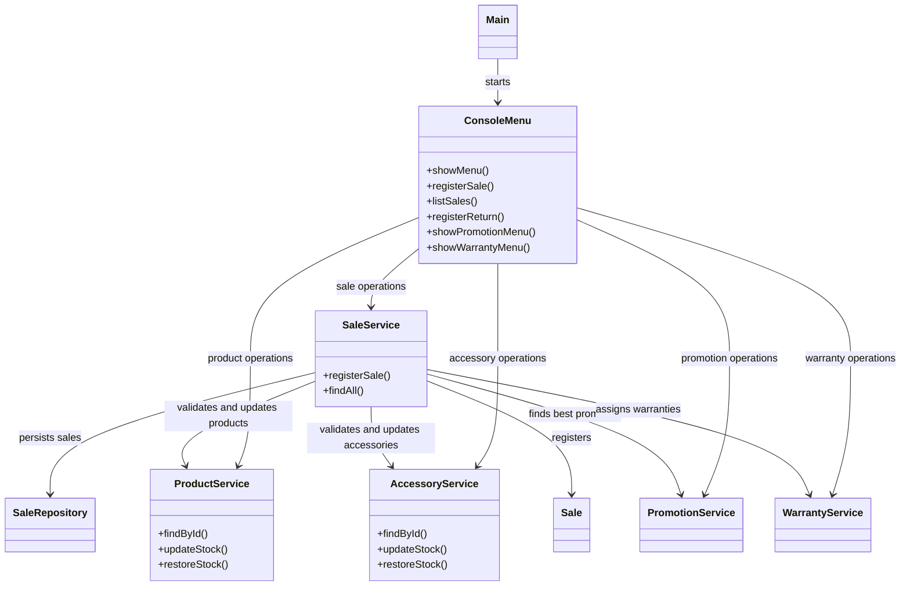
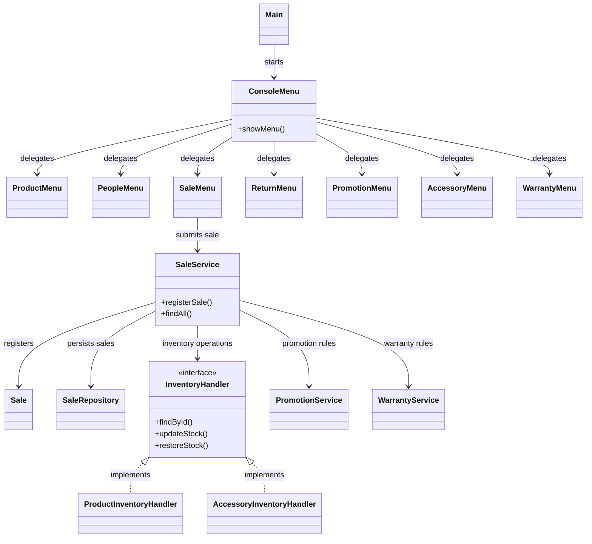

# GRASP Class Diagrams — GameZoneUnicesar

## 1. Purpose

This document presents the current design based on the Technical Leader's preliminary audit and a proposed design for addressing findings V-01 and V-03.

The proposed design is conceptual. The classes and interfaces introduced in the target diagram must not be considered implemented until the team approves and develops them.

## 2. Before Refactoring — Current Design

The following diagram summarizes the relevant classes and dependencies identified during the Technical Leader's review. It focuses on the sale workflow and its integration with the user interface and inventory modules.

### Observed design concerns

- **V-01 — High Cohesion:** `ConsoleMenu` contains interaction flows for multiple independent modules.
- **V-02 — Low Coupling:** Sale-related checks are distributed between the UI and service layers.
- **V-03 — Polymorphism / Protected Variations:** `SaleService` uses concrete-type checks to select product or accessory inventory operations.

These findings remain subject to final team validation.

## 3. After Refactoring — Proposed Design

The following diagram illustrates one possible target design. It proposes extracting module-specific UI components and introducing a common inventory-handling abstraction.

## 4. Relationship Between Findings and Proposed Changes

| Finding | Proposed change | Intended benefit |
|---|---|---|
| V-01 | Extract module-specific UI components while keeping `ConsoleMenu` as the entry point. | Improve High Cohesion and make UI changes easier to maintain. |
| V-02 | Keep authoritative business validation in the service layer and limit the UI to interaction and presentation responsibilities. | Reduce duplicated rules and unnecessary coupling. |
| V-03 | Evaluate a common inventory-handling interface for products and accessories. | Apply Polymorphism and reduce dependence on concrete inventory categories. |

## 5. Refactoring Constraints

1. Preserve existing menu options, Spanish messages, and user workflows.
2. Preserve sale calculations, promotions, warranty assignment, inventory updates, and return behavior.
3. Avoid introducing unnecessary abstractions before reviewing the complete codebase.
4. Confirm the exact method signatures and dependencies before implementing the proposed classes.
5. Update this diagram after the team agrees on the final design and again after implementation.

## 6. Implementation Status

- Current-design diagram: preliminary, based on the Technical Leader's review.
- Target-design diagram: proposed; not yet implemented.
- Developer 1's Product module audit: pending.
- Developer 2's People module audit: pending.
- Final architecture approval: pending team review.
