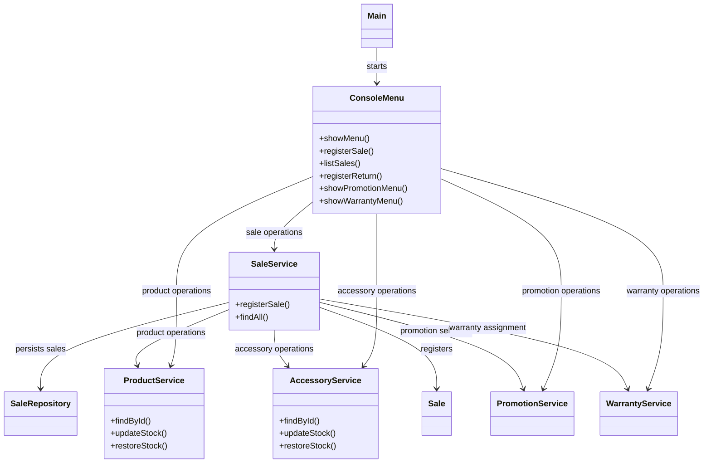
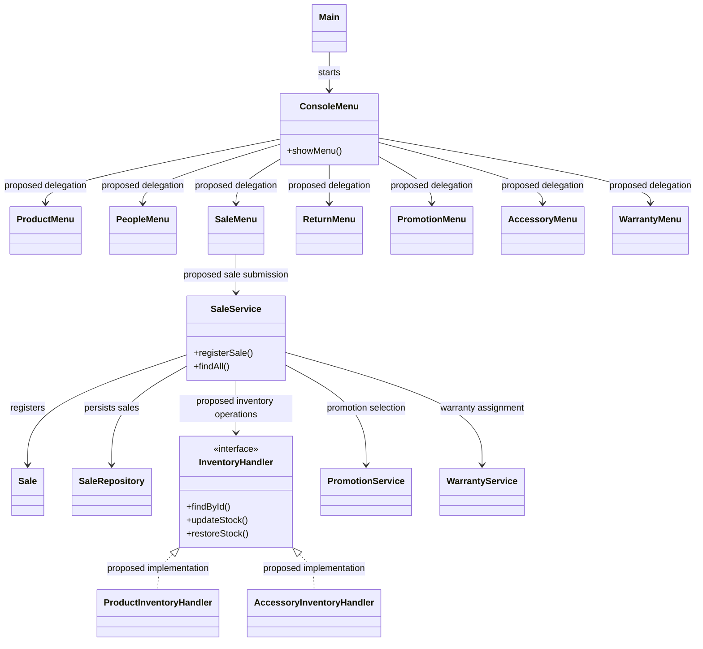

# GRASP Class Diagrams — GameZoneUnicesar

## 1. Purpose

This document records the preliminary design of the Sales and UI integration modules and a conceptual target design for potential GRASP corrections.

The current-design diagram represents the relevant responsibilities and dependencies identified during the audit. The target-design diagram is a proposal, not a statement of implemented architecture. Any proposed class, interface, or dependency must be validated against the source code and approved by the team before implementation.

Product and People module corrections have been recorded in the `feature/grasp-refactor` branch. Those changes must be represented separately from the proposed Sales and UI changes.

## 2. Before Refactoring — Audited Sales and UI Design

The following diagram summarizes the relevant classes and dependencies identified during the Technical Leader's preliminary review. It focuses on sales registration and its integration with the console UI and inventory modules.

### Preliminary findings

The following findings originated in the Technical Leader's preliminary audit. Their identifiers must be reconciled with the Developer 1 and Developer 2 reports before the consolidated audit is finalized.

- **Leader V-01 — High Cohesion:** `ConsoleMenu` handles interaction flows for several independent modules.
- **Leader V-02 — Low Coupling:** Sale-related checks may be duplicated across the UI and service layers.
- **Leader V-03 — Polymorphism / Protected Variations:** `SaleService` uses concrete-type checks to choose between product and accessory inventory operations.

These findings remain subject to team validation. A proposed correction must address the demonstrated design problem while preserving external behavior.

## 3. After Refactoring — Conceptual Target Design

The following diagram is a candidate design, not a record of implemented classes. The team must confirm whether a shared inventory abstraction is justified and whether extracting module-specific UI components is within the approved correction scope.

### Target-design constraints

- Do not treat `InventoryHandler`, `ProductInventoryHandler`, `AccessoryInventoryHandler`, or the proposed menu classes as implemented unless their source files and dependencies are verified.
- Agree on interface signatures and module ownership before modifying shared code.
- Review the return workflow as well as sale registration before finalizing a common inventory abstraction.
- Keep separate findings when they represent distinct causes or responsibilities, even if they affect the same classes.

## 4. Relationship Between Findings and Proposed Changes

| Preliminary finding | Proposed direction | Validation required |
|---|---|---|
| Leader V-01 — High Cohesion | Consider extracting module-specific UI responsibilities from `ConsoleMenu`. | Confirm scope, ownership, and preservation of menu behavior. |
| Leader V-02 — Low Coupling | Keep authoritative business validation in the service layer and avoid redundant business rules in the UI. | Compare the actual validation responsibilities and error behavior. |
| Leader V-03 — Polymorphism / Protected Variations | Evaluate a common inventory-handling abstraction or another design that removes unnecessary concrete-type branching. | Review sale and return flows and coordinate with the Product and Accessory module owners. |

These are preliminary references, not final consolidated IDs. The consolidated audit must assign unique identifiers and retain references to the original reports.

## 5. Refactoring Constraints

1. Preserve menu options, Spanish messages, customer and seller selection, and existing user workflows.
2. Preserve sale calculations, promotion selection, warranty assignment, stock changes, return processing, and displayed totals.
3. Do not introduce abstractions solely to satisfy a pattern name; demonstrate the design problem and the benefit of the proposed correction.
4. Confirm class responsibilities, method signatures, and dependencies against the source code before implementation.
5. Coordinate changes that cross module boundaries with the affected developers.
6. Update the diagrams after approving the target design and again after implementation.
7. Record actual compilation and regression-test results without marking unexecuted checks as passed.

## 6. Implementation and Review Status

- Current Sales and UI diagram: preliminary; must be checked against the audited source version.
- Target Sales and UI diagram: conceptual proposal; approval and implementation remain to be verified.
- Product and People audit reports: available for consolidation.
- Product persistence, category handling, `ProductService` dependency injection, and `PersonStorage` abstraction: corrections are recorded in `feature/grasp-refactor`; each must be traced to its validated finding.
- Final consolidated findings and nine-pattern verdicts: require team validation.
- Final architecture approval and regression validation: pending documented evidence.
